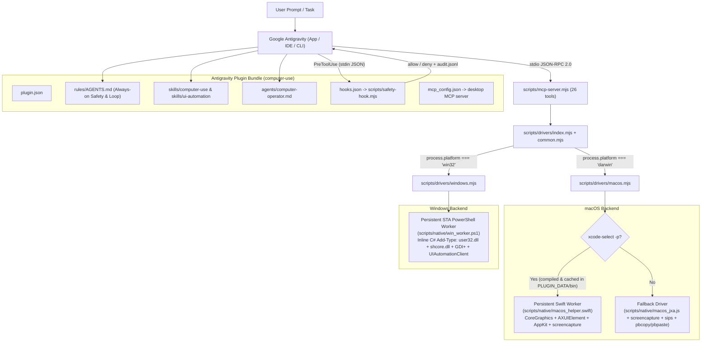
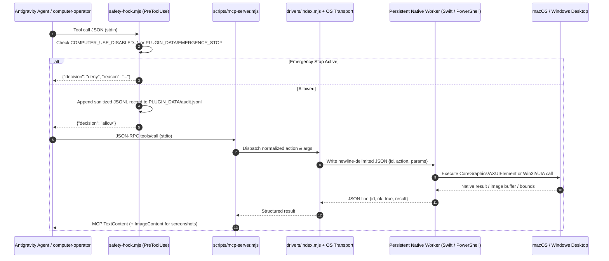
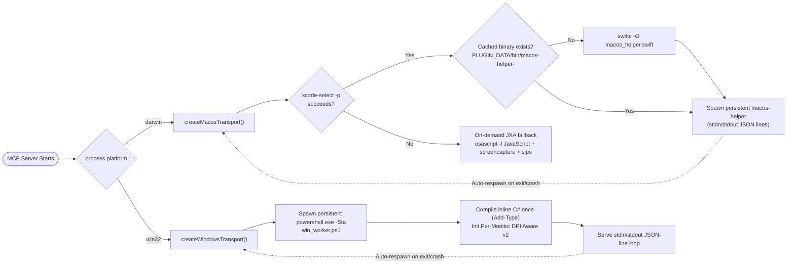
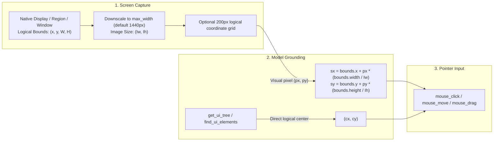
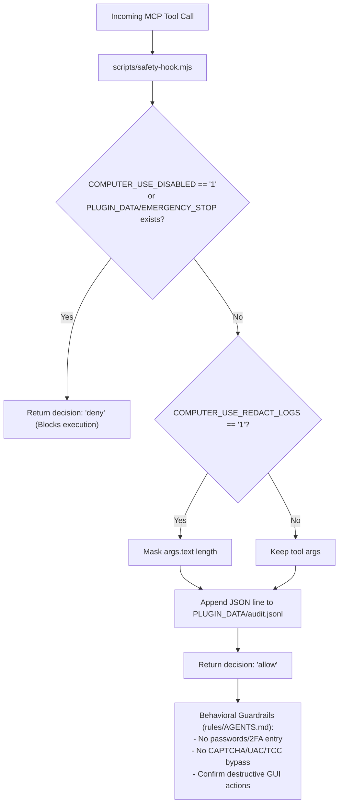

# Architecture — Computer Use Plugin for Google Antigravity

This document describes the architecture, runtime components, data flows, coordinate math, and cross-platform driver design of the **Computer Use** plugin (`computer-use` v1.0.0).

---

## 1. High-Level System Architecture

The plugin combines Antigravity's native customization primitives (**Skills**, **Rules**, **Custom Agent**, **Lifecycle Hooks**, and **MCP Server**) with a **zero-dependency Node.js MCP server** that delegates OS operations to persistent native workers on **macOS** and **Windows**.



---

## 2. Repository & Bundle Layout

```text
agy-computer-use-plugin/
├── plugin.json                              # Plugin manifest & Marketplace metadata
├── mcp_config.json                          # Registers 'desktop' stdio MCP server + eager tool list
├── hooks.json                               # Registers PreToolUse safety & audit hook
├── rules/
│   └── AGENTS.md                            # Always-on Observe-Ground-Act-Verify & safety guardrails
├── agents/
│   └── computer-operator.md                 # Dedicated desktop operator main/subagent
├── skills/
│   ├── computer-use/
│   │   ├── SKILL.md                         # Cross-platform desktop automation runbook
│   │   └── references/
│   │       └── platform-guide.md            # Modifier mappings, key names, DPI & TCC guide
│   └── ui-automation/
│       └── SKILL.md                         # Accessibility-first UI tree grounding guide
├── scripts/
│   ├── mcp-server.mjs                       # Zero-dep JSON-RPC 2.0 MCP server (26 tools)
│   ├── safety-hook.mjs                      # PreToolUse EMERGENCY_STOP gate + audit.jsonl logger
│   ├── drivers/
│   │   ├── common.mjs                       # Key/modifier normalization, UI filter, path helpers
│   │   ├── index.mjs                        # Unified 26-method driver facade over OS transports
│   │   ├── macos.mjs                        # macOS transport (Swift worker + JXA fallback)
│   │   └── windows.mjs                      # Windows transport (persistent STA PowerShell worker)
│   └── native/
│       ├── macos_helper.swift               # Native Swift worker (CoreGraphics, AXUIElement, AppKit)
│       ├── macos_jxa.js                     # Zero-Xcode JXA fallback script
│       └── win_worker.ps1                   # Persistent PS 5.1+ / C# .NET 4.8 Win32 + UIA worker
├── tests/
│   └── plugin.test.mjs                      # Unit, hook, static Windows PS5.1, & live MCP tests
├── assets/
│   └── logo.svg                             # 128x128 light/dark-compatible SVG icon
├── PRD.md                                   # Product Requirements Document
├── FUTURE_DEVELOPMENT.md                    # Roadmap: Token efficiency, agy-context-plugin, guardrails, perf
└── ARCHITECTURE.md                          # This file
```

---

## 3. End-to-End Execution & Safety Flow

Every desktop tool call flows through the `PreToolUse` safety hook before reaching `scripts/mcp-server.mjs` and the persistent OS worker.



---

## 4. Cross-Platform Driver Selection & Lifecycle

`scripts/drivers/index.mjs` exposes one unified 26-method API (`getSystemInfo`, `screenshot`, `mouseClick`, `hotkey`, `getUiTree`, etc.) backed by thin OS transports.



### Key Design Choices
- **Zero `npm` dependencies**: Implementing JSON-RPC 2.0 directly in [scripts/mcp-server.mjs](file:///Users/omerokumus/Documents/Projects/agy-computer-use-plugin/scripts/mcp-server.mjs) eliminates `node_modules`, `node-gyp`, and ABI mismatches across Node versions and CPU architectures (`arm64` / `x86_64`).
- **Persistent Workers**: Both `macos_helper.swift` and `win_worker.ps1` stay resident across calls over `stdin`/`stdout` JSON lines, avoiding repeated `swiftc` or PowerShell `Add-Type` startup overhead (~300–500ms paid once at first call, then ~10–50ms per action).
- **Content-Hashed Swift Caching**: `macos.mjs` hashes `macos_helper.swift` (12-char SHA-256 prefix) and caches the compiled binary in `${PLUGIN_DATA}/bin/macos-helper-<hash>`, automatically recompiling when the plugin updates.
- **PowerShell 5.1 + .NET Framework 4.8 Compatibility**: `win_worker.ps1` uses `-Sta` (required by `System.Windows.Forms.Clipboard`) and avoids PowerShell 7+ or .NET Core-only APIs so it works out of the box on stock Windows 10 and 11.

---

## 5. Coordinate Space & HiDPI Scaling

All tools standardize on a **top-left primary-display `(0, 0)` origin** across both operating systems. Secondary displays positioned left or above the primary monitor carry negative `x` or `y` coordinates.



### OS-Specific Coordinate Details
- **macOS (`CoreGraphics` vs `AppKit`)**:
  - `CGDisplayBounds`, `CGWindowListCopyWindowInfo`, `CGEvent.location`, `AXPosition`, and `CGEventCreateMouseEvent` all use **top-left logical points** (`3008x1692` on a 2x Retina display).
  - `NSScreen.visibleFrame` uses AppKit's **bottom-left** origin; `macos_helper.swift` and `macos_jxa.js` flip `work_area.y` via `primaryHeight - (vf.origin.y + vf.size.height)` so `work_area` matches CoreGraphics top-left space.
- **Windows (`Per-Monitor DPI Aware v2`)**:
  - `win_worker.ps1` calls `SetProcessDpiAwarenessContext((IntPtr)(-4))` (with `SetProcessDPIAware()` fallback) at startup so `Screen.AllScreens`, `DwmGetWindowAttribute` (`DWMWA_EXTENDED_FRAME_BOUNDS`), `GetCursorPos`, `SetCursorPos`, `SendInput`, `CopyFromScreen`, and `UIAutomationClient` `BoundingRectangle` all share exact unvirtualized virtual-screen coordinates.

---

## 6. Key Normalization & Accessibility Grounding

### Cross-Platform Key & Modifier Mapping (`scripts/drivers/common.mjs`)
- **`"primary"` modifier**: Automatically maps to `"cmd"` on macOS (`darwin`) and `"ctrl"` on Windows (`win32`).
- **Aliases**: Normalized uniformly (`return` → `enter`, `esc` → `escape`, `option` → `alt`, `command` → `cmd`, `control` → `ctrl`, `win`/`super` → `meta`).
- **Unicode typing**:
  - `macos_helper.swift`: Posts `CGEvent` keyboard events with `keyboardSetUnicodeString` (UTF-16) for arbitrary characters regardless of active keyboard layout (with `via_clipboard: true` fallback using `NSPasteboard` + `Cmd+V`).
  - `win_worker.ps1`: Uses `SendInput` with `KEYEVENTF_UNICODE` scan codes (plus `KEYEVENTF_EXTENDEDKEY` for navigation/Win keys, and `Clipboard.SetText` + `Ctrl+V` when `via_clipboard: true`).

### macOS Accessibility Trust Handling
On macOS, when Antigravity spawns `language_server` → `node` → `macos-helper`, `AXIsProcessTrusted()` can return `false` inside a running subprocess due to TCC process-token caching even after Accessibility is granted to Antigravity. To avoid false negatives:
- `macos_helper.swift` calls `probeAccessibility()` (testing `AXIsProcessTrusted()` and live `AXUIElementCopyAttributeValue` queries) in `check_permissions`.
- Action handlers execute directly against `AXUIElement` / `CGEventPost` instead of pre-blocking on `AXIsProcessTrusted()`.

---

## 7. Safety & Guardrail Architecture



---

## 8. MCP Tool Suite (26 Tools)

`mcp_config.json` marks the 12 most frequent perception, input, UI, and window tools as **`eager: true`** and leaves 14 specialized tools lazy-loaded to minimize baseline context overhead.

| Category | Tools (`*` = eager) | macOS Implementation | Windows Implementation |
| --- | --- | --- | --- |
| **Perception & Diagnostics** | `screenshot`* , `get_screen_info`* , `check_permissions` , `get_system_info` | `screencapture` + `CGContext` / `CGImageDestination`, `CGGetActiveDisplayList`, `AXIsProcessTrusted` + probe | `Graphics.CopyFromScreen`, `Screen.AllScreens`, `shcore.dll` DPI, `WindowsIdentity` |
| **Mouse** | `mouse_click`* , `mouse_drag`* , `mouse_scroll`* , `mouse_move` , `mouse_down` , `mouse_up` | `CGEvent(mouseEventSource:)`, `CGEvent(scrollWheelEvent2Source:)` | `SetCursorPos` + `SendInput` (`INPUT_MOUSE`, `WHEEL`, `HWHEEL`) |
| **Keyboard** | `type_text`* , `press_key`* , `hotkey`* , `key_down` , `key_up` | `CGEvent` + `keyboardSetUnicodeString` / `CGKeyCode` | `SendInput` (`KEYEVENTF_UNICODE`, `VK_*`, `KEYEVENTF_EXTENDEDKEY`) |
| **Accessibility / UI** | `get_ui_tree`* , `click_ui_element`* , `find_ui_elements` | `AXUIElementCreateApplication` + `kAXChildrenAttribute` | `AutomationElement.FromHandle` + `TreeWalker.ControlViewWalker` |
| **Windows & Apps** | `list_windows`* , `focus_window`* , `manage_window` , `list_running_apps` , `launch_app` | `CGWindowListCopyWindowInfo`, `NSRunningApplication`, `AXUIElement`, `/usr/bin/open` | `EnumWindows`, `DwmGetWindowAttribute`, `AttachThreadInput` + `SetForegroundWindow`, `Process.Start` |
| **Clipboard & Timing** | `clipboard_read` , `clipboard_write` , `wait` | `NSPasteboard.general` (`pbpaste`/`pbcopy` fallback), Node timer | `System.Windows.Forms.Clipboard` (STA), Node timer |
