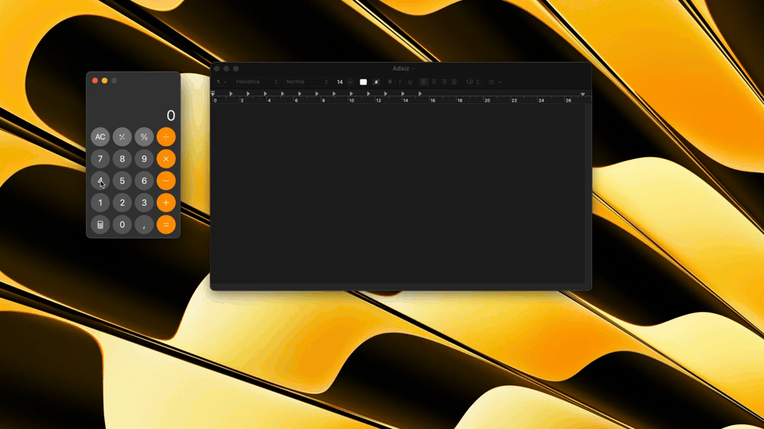

# Computer Use Plugin for Google Antigravity

A zero-dependency, cross-platform **Computer Use** plugin for **Google Antigravity** (App, IDE, and CLI) that gives agents full native desktop perception and control on both **macOS** and **Windows**.

> **Docs:** [Architecture & Diagrams](ARCHITECTURE.md) · [PRD](PRD.md) · [Roadmap](FUTURE_DEVELOPMENT.md) · [Platform Shortcuts Guide](skills/computer-use/references/platform-guide.md)



---

## Features

- **Screen Perception**: Multi-monitor `get_screen_info`, compressed multimodal `screenshot` (full screen, display, window, or region, with optional 200px coordinate grid and cursor capture), and `check_permissions`.
- **Full Mouse Control**: `mouse_move`, `mouse_click` (left/right/middle, single/double/triple, modifiers), `mouse_down`, `mouse_up`, `mouse_drag`, and `mouse_scroll`.
- **Unicode Keyboard Control**: Direct Unicode `type_text` (or fast clipboard paste via `via_clipboard: true`), `press_key`, `key_down`, `key_up`, and cross-platform `hotkey` (`"primary"` maps to `cmd` on macOS and `ctrl` on Windows).
- **Accessibility / Semantic UI**: Native `get_ui_tree`, `find_ui_elements`, and `click_ui_element` powered by macOS `AXUIElement` and Windows `UIAutomationClient`.
- **Window & App Lifecycle**: `list_windows`, `focus_window`, `manage_window` (move, resize, `set_bounds`, minimize, maximize, restore, close), `list_running_apps`, and `launch_app`.
- **Clipboard & Timing**: `clipboard_read`, `clipboard_write`, and `wait` (with optional post-wait screenshot).
- **Zero External Dependencies**: Pure Node.js ESM JSON-RPC 2.0 `stdio` MCP server (`scripts/mcp-server.mjs`) backed by native OS drivers (`macos_helper.swift` / JXA fallback on macOS; persistent STA PowerShell + C# `win_worker.ps1` on Windows).
- **Safety & Guardrails**: Always-on `rules/AGENTS.md`, dedicated `computer-operator` agent, and a `PreToolUse` safety/audit hook (`hooks.json`) with `EMERGENCY_STOP` support.

---

## Installation

### Prerequisites

- **Node.js 18+** installed and available on `PATH` (macOS or Windows).
- **macOS 13+**: Grant **Screen Recording** and **Accessibility** permissions to your Antigravity app / terminal under *System Settings → Privacy & Security* (restart Antigravity if toggled while running). Xcode Command Line Tools (`xcode-select --install`) enable the fast Swift helper; otherwise the built-in JXA fallback is used automatically.
- **Windows 10 / 11**: Works out of the box using built-in `powershell.exe` + .NET Framework (`System.Windows.Forms`, `System.Drawing`, `UIAutomationClient`).

### Option 1 — Antigravity CLI (`agy`) (Recommended)

Install directly from GitHub:

```bash
agy plugin install https://github.com/omerokumus1/agy-computer-use-plugin
```

Or validate and install from a local clone:

```bash
git clone https://github.com/omerokumus1/agy-computer-use-plugin.git
cd agy-computer-use-plugin
agy plugin validate --strict .
agy plugin install .
```

### Option 2 — Manual Global Installation

Clone or copy this repository into your global Antigravity plugins directory, then enable **Computer Use** under **Customizations → Installed**:

- **macOS**: `~/.gemini/config/plugins/computer-use/`
- **Windows**: `%USERPROFILE%\.gemini\config\plugins\computer-use\`

### Option 3 — Workspace-Only Installation

To enable the plugin only for a single project, copy or clone it into `.agents/plugins/computer-use/` at your project root.

---

## Usage

1. Ask Antigravity in natural language to interact with any desktop application (e.g., *"Take a screenshot and summarize open windows"*, *"Open Calculator and compute 42 × 7"*, or *"Inspect the active app's UI tree"*).
2. Invoke bundled skills explicitly in chat with `/computer-use` or `/ui-automation`.
3. Select the bundled **`computer-operator`** agent in the Antigravity App agent picker, via `/agents` in the CLI, or directly from a shell:

   ```bash
   agy --agent computer-operator
   ```

4. Check OS permissions and display layout at any time by asking Antigravity to run `check_permissions` and `get_screen_info`.

---

## MCP Tool Suite (26 Tools)

| Category | Tools |
| --- | --- |
| **Perception & Diagnostics** | `screenshot`, `get_screen_info`, `check_permissions`, `get_system_info` |
| **Mouse** | `mouse_move`, `mouse_click`, `mouse_down`, `mouse_up`, `mouse_drag`, `mouse_scroll` |
| **Keyboard** | `type_text`, `press_key`, `hotkey`, `key_down`, `key_up` |
| **Accessibility / UI** | `get_ui_tree`, `find_ui_elements`, `click_ui_element` |
| **Windows & Apps** | `list_windows`, `focus_window`, `manage_window`, `list_running_apps`, `launch_app` |
| **Clipboard & Timing** | `clipboard_read`, `clipboard_write`, `wait` |

---

## Project Structure

```text
agy-computer-use-plugin/
├── plugin.json                              # Antigravity plugin manifest (v1.0.0)
├── mcp_config.json                          # Registers 'desktop' stdio MCP server
├── hooks.json                               # PreToolUse safety & audit hook
├── assets/
│   ├── logo.svg                             # 1:1 light/dark vector icon
│   └── demo-showcase.gif                    # Inline README preview (960x540)
├── rules/
│   └── AGENTS.md                            # Always-on safety & observe-act-verify rules
├── agents/
│   └── computer-operator.md                 # Dedicated desktop GUI main/subagent
├── skills/
│   ├── computer-use/
│   │   ├── SKILL.md                         # Cross-platform desktop automation workflow
│   │   └── references/platform-guide.md     # Key/modifier mappings & OS permission guide
│   └── ui-automation/
│       └── SKILL.md                         # Accessibility-first UI tree grounding
├── scripts/
│   ├── mcp-server.mjs                       # Zero-dependency Node.js MCP server
│   ├── safety-hook.mjs                      # PreToolUse EMERGENCY_STOP & audit logger
│   ├── drivers/
│   │   ├── common.mjs                       # Key normalization & UI element filtering
│   │   ├── index.mjs                        # Unified cross-platform driver facade
│   │   ├── macos.mjs                        # macOS transport (Swift + JXA fallback)
│   │   └── windows.mjs                      # Windows transport (persistent STA PowerShell)
│   └── native/
│       ├── macos_helper.swift               # Native CoreGraphics / AXUIElement / AppKit worker
│       ├── macos_jxa.js                     # Zero-Xcode JXA fallback
│       └── win_worker.ps1                   # Persistent Win32 / GDI+ / UIAutomation worker
└── tests/
    └── plugin.test.mjs                      # Unit, hook, static Windows, & live MCP tests
```

---

## Emergency Stop & Safety Guardrails

The bundled `PreToolUse` safety hook logs invocations to `${PLUGIN_DATA}/audit.jsonl` (set `COMPUTER_USE_REDACT_LOGS=1` to mask `type_text` / `clipboard_write` text).

To immediately pause/block all computer-use tool calls:
- Create an empty file named `EMERGENCY_STOP` inside `${PLUGIN_DATA}`, **or**
- Set the environment variable `COMPUTER_USE_DISABLED=1`.

---

## Testing & Validation

```bash
agy plugin validate --strict .
node --test tests/plugin.test.mjs
```

---

## Troubleshooting

- **macOS `screenshot` fails or captures only wallpaper**: Grant **Screen & System Audio Recording** to Antigravity (or your terminal) in *System Settings → Privacy & Security*, then restart Antigravity.
- **macOS clicks/keystrokes or `get_ui_tree` fail**: Grant **Accessibility** to Antigravity in *System Settings → Privacy & Security* and restart Antigravity.
- **Windows input blocked on Admin windows**: Windows UIPI blocks input from non-elevated processes into elevated (Administrator) windows; run at a matching privilege level only when explicitly needed.
- **Changes not taking effect after updating files**: Re-run `agy plugin install .` or toggle **Disable → Enable** on **Computer Use** under **Customizations → Installed**.

---

## Documentation

- [Architecture & Diagrams](ARCHITECTURE.md)
- [Product Requirements Document](PRD.md)
- [Future Development & Roadmap](FUTURE_DEVELOPMENT.md)
- [Platform Shortcuts & Coordinate Guide](skills/computer-use/references/platform-guide.md)

---

## Contact

- **GitHub**: [@omerokumus1](https://github.com/omerokumus1)
- **LinkedIn**: [Ömer Faruk Okumuş](https://www.linkedin.com/in/omerokumus1/)
- **X (Twitter)**: [@omerokumusx](https://x.com/omerokumusx)

---

## License

[MIT](LICENSE)
